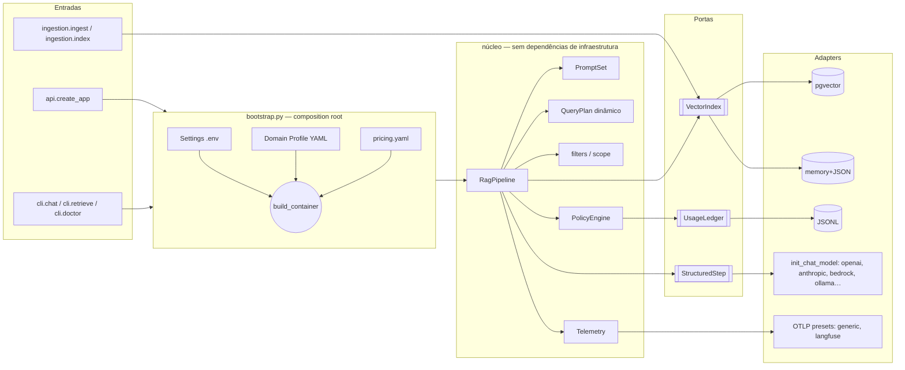

# 1. Visão geral e arquitetura

## Objetivo

Oferecer um pipeline de RAG **observável** e **governado** que possa ser aplicado a
qualquer base de conhecimento, com qualquer provedor de modelos e qualquer vector store,
trocando configuração — não código.

O ponto de partida é o projeto didático
[`devfullcycle/mba-ia-rag` (branch `observability`)](https://github.com/devfullcycle/mba-ia-rag/tree/observability),
que já resolvia muito bem o *método*: query planning com pedido de esclarecimento,
filtro de metadados eliminatório, reranking, fontes controladas pela aplicação,
OpenTelemetry sem SDK de backend, política de telemetria por ambiente e governança de
custo. O que ele não resolvia era a **generalização**: o domínio (a FCAI), o provedor
(OpenAI) e a infraestrutura (pgvector, arquivo JSONL) estavam no código.

## Metas

- Domínio 100% declarativo (Domain Profile).
- Núcleo sem dependência de provedor, vector store, ledger ou backend de observabilidade.
- Preservar todas as garantias do upstream (ver [03](03-pipeline.md)).
- Rodar e ser testável sem infraestrutura.
- Suportar multi-tenancy real (escopo por requisição).

## Não-metas

- Não é um framework de agentes nem de conversação com memória (cada pergunta é
  independente, como no upstream).
- Não é billing: custos são estimativas.
- Não inclui UI.

## Arquitetura



## Mapa de módulos

```
rag_observability/
  settings.py              # deployment: provedores, endpoints, limites (env)
  bootstrap.py             # composition root
  api.py                   # FastAPI (create_app, ScopeResolver)
  domain/
    profile.py             # DomainProfile (YAML) + validações
    query_plan.py          # QueryPlan gerado das facetas
  core/
    pipeline.py            # o fluxo: política → plano → busca → rerank → resposta
    prompts.py             # prompts montados do profile
    filters.py             # escopo + facetas → DSL de filtros
    results.py             # resultado, debug, fontes
    ports.py               # VectorIndex, UsageLedger, StructuredStep
    errors.py              # erros tipados
  governance/              # política, preços, ledgers
  observability/           # convenções, presets OTLP, Telemetry
  providers/               # fábricas de modelos e registry de adapters
  vectorstores/            # pgvector, memory
  ingestion/               # loaders, chunking, manifest, ingest, index
  cli/                     # chat, retrieve, doctor
profiles/<nome>/           # profile.yaml + knowledge_base/
config/pricing.yaml
tests/                     # suíte offline com fakes
```
