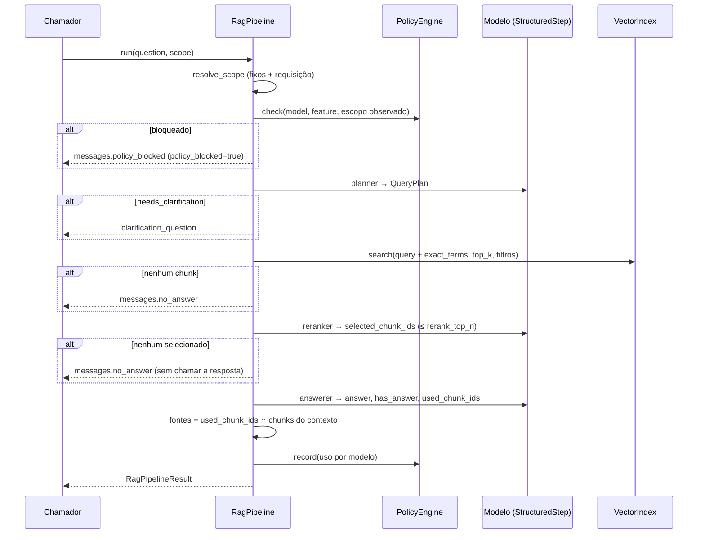

# 3. Pipeline e contratos

## Fluxo



## Garantias (herdadas do upstream, preservadas)

1. **Política antes de tudo.** Requisição bloqueada não chega a planner, busca ou modelo.
2. **Esclarecer em vez de chutar.** Pergunta com mais de uma leitura retorna pergunta de
   esclarecimento.
3. **Filtro eliminatório com cautela.** O planner lista *todos* os valores possíveis numa
   faceta múltipla e deixa vazio quando em dúvida.
4. **Parar cedo.** Sem chunks ou sem chunks relevantes, o modelo de resposta não é
   chamado.
5. **Fontes da aplicação.** Ids citados pelo modelo são cruzados com o contexto real;
   ids inventados são descartados.
6. **Autorização fora do modelo.** Escopo é aplicado pelo código; facetas não podem
   tocá-lo.

## Contrato de entrada

```python
pipeline.run(
    question: str,
    *, scope: dict | None = None,     # só campos de scope.request_fields
    use_rerank: bool = True,
    include_debug: bool = False,
    on_prompt: Callable[[str, PromptValue], None] | None = None,  # só terminal
) -> RagPipelineResult
```

## Contrato de saída

```json
{
  "request_id": "uuid",
  "answer": "…",
  "has_answer": true,
  "needs_clarification": false,
  "policy_blocked": false,
  "sources": [{"source_file": "…", "title": "…", "section": "…", "attributes": {"version": "2026-01"}}],
  "debug": {
    "request_id": "…", "profile": "…",
    "policy": {"allowed": true, "reason": "within policy", "scope": {"tenant": "fcai"}, "...": "..."},
    "query_plan": {"normalized_question": "…", "facets": {"doc_types": ["sla"]}, "filters": {}, "...": "..."},
    "retrieved_chunks": [], "selected_chunk_ids": [],
    "timings": {"query_planning_ms": 0, "retrieval_ms": 0, "reranking_ms": 0, "answer_generation_ms": 0, "total_ms": 0},
    "model_usage": [{"model": "…", "input_tokens": 0, "output_tokens": 0, "total_tokens": 0, "estimated_cost_usd": 0}],
    "estimated_cost_usd": 0
  }
}
```

Novidades em relação ao upstream: `request_id` e `policy_blocked` no topo, `attributes`
nas fontes, `facets` no lugar de `doc_types`/`plan`, custo por modelo.

## Ingestão e indexação

1. **Loader** (`markdown`): front matter YAML + corpo.
2. **Validação**: `required_metadata` e valores de faceta.
3. **Chunking**: headings → tamanho → cabeçalho de contexto; id determinístico
   `<arquivo>-<hash12>-<índice>`.
4. **Indexação incremental**: manifest por coleção em `data/<collection>/` com hash por
   documento; só novo/alterado é reindexado, removido é apagado. Rebuild automático sem
   manifest, sem coleção ou com **fingerprint** de embeddings diferente.
