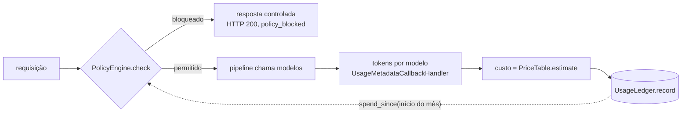

# 5. Governança operacional

> Observabilidade mostra o que aconteceu; governança decide o que ainda pode acontecer.

## Regras

| Configuração | Efeito |
| --- | --- |
| `AI_ALLOWED_MODELS` | `LLM_MODEL` fora da lista → bloqueio (`model not allowed`) |
| `AI_MONTHLY_BUDGET_USD` | gasto estimado do mês ≥ orçamento → bloqueio (`monthly budget reached`) |
| `AI_MAX_OUTPUT_TOKENS` | vai para o modelo como `max_tokens` |
| `AI_PRICING_PATH` | tabela de preços por modelo; modelo permitido sem preço → **não sobe** |
| `AI_USAGE_LEDGER` | `jsonl` \| `memory` \| `none` \| `pacote.modulo:Fabrica` |
| `RAG_FEATURE` | nome da superfície de produto (chave do orçamento) |

O orçamento é por **feature + escopo observado** (`scope.observed_fields` do profile):
cada tenant/empresa tem seu próprio gasto.

## Ciclo



## Registro do ledger

```json
{"request_id": "…", "timestamp": "2026-11-07T12:00:00+00:00", "feature": "rag_chat",
 "scope": {"tenant": "fcai", "product": "fcai-cloud"}, "provider": "openai",
 "model": "gpt-4.1-mini", "input_tokens": 3522, "output_tokens": 198,
 "total_tokens": 3720, "estimated_cost_usd": 0.00172}
```

Uma linha por modelo usado. Só execuções que chamaram modelo entram.

## Limites conhecidos

- Estimativa, não billing. Confira `config/pricing.yaml` com a tabela do provedor.
- O ledger `jsonl` lê o arquivo inteiro e não coordena processos — use um adapter
  transacional em produção (ver [06](06-extensao.md)).
- Checagem e registro não são atômicos: requisições concorrentes podem ultrapassar o
  orçamento em algumas execuções.
- As ferramentas de inspeção (`cli.retrieve`) não passam pela política (só embeddings).
